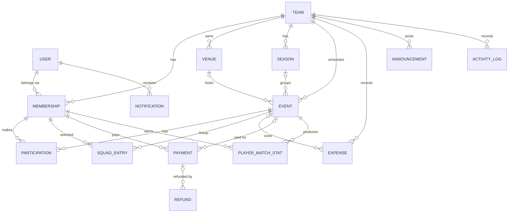

# Football Team Manager — System Design Document

| | |
|---|---|
| Version | 1.0 |
| Date | 2026-10-09 |
| Author | <your name> |
| Status | Approved for implementation |

---

## 1. Introduction

### 1.1 Purpose
This document describes the architecture, data model, business rules and API
of Football Team Manager, a multi-team web platform for local football teams to
organise matches, seats, payments, squads and statistics.

### 1.2 Scope
Version 1 is a web application (installable as a PWA on phones) with a Django
REST API backend and a React single-page frontend.

### 1.3 Definitions

| Term | Meaning |
|---|---|
| Team | An independent club. All data belongs to exactly one team. |
| Member | A user's membership in one team (role + player profile). |
| Manager | A member whose role is Owner, Admin or Captain. |
| Event | A match or a training session. |
| Participation | One member's response to one event (availability and seat). |
| Seat | One of an event's `capacity` playing places. |
| Advance | Optional prepayment that secures a seat once approved. |
| Fee | A member's final share of an event's cost. |

---

## 2. Requirements

### 2.1 Functional requirements (v1)

| ID | Module | Requirement |
|---|---|---|
| FR-01 | Accounts | Register, log in, log out, edit profile, change password |
| FR-02 | Teams | Create team; creator becomes Owner |
| FR-03 | Teams | Join via invite code; managers approve or reject requests |
| FR-04 | Teams | Change roles, remove members, leave team, regenerate invite code |
| FR-05 | Venues | Managers maintain reusable venues (turfs) per team |
| FR-06 | Events | Managers create, edit, cancel matches and training sessions |
| FR-07 | Events | Calendar list of events with filters |
| FR-08 | Seats | Members respond: want to play, maybe, unavailable, cancel |
| FR-09 | Seats | Capacity, waitlist, automatic promotion, registration deadline |
| FR-10 | Finance | Event expenses and automatic per-player fee with rounding |
| FR-11 | Finance | Members submit payments; managers approve, reject, record cash |
| FR-12 | Finance | Balances per member, per event and per team |
| FR-13 | Finance | Refunds, including automatic ones when an event is cancelled |
| FR-14 | Squad | Formation, starting XI, substitutes, reserves |
| FR-15 | Stats | Final score and per-player match stats; player and team totals |
| FR-16 | Seasons | Group events into seasons; totals per season |
| FR-17 | Comms | Team announcements |
| FR-18 | Comms | In-app notifications |
| FR-19 | Audit | Activity log of important actions |
| FR-20 | Platform | Super admin manages everything through the Django admin |

### 2.2 Out of scope for v1 (planned later)
Team chat and polls, media gallery, competitions and league standings,
Google/Apple login, email and push notifications, online payment gateway,
PDF/Excel export, native mobile apps.

### 2.3 Non-functional requirements

| ID | Requirement |
|---|---|
| NFR-01 | **Isolation:** no API call can read or change another team's data |
| NFR-02 | **Security:** hashed passwords, JWT auth, HTTPS in production, rate-limited login |
| NFR-03 | **Integrity:** money stored as Decimal; seat capacity never exceeded, even with simultaneous requests |
| NFR-04 | **Auditability:** every payment and role change is logged with actor and time |
| NFR-05 | **Time:** stored in UTC, displayed in Asia/Dhaka |
| NFR-06 | **Currency:** BDT (৳), two decimal places |
| NFR-07 | **Usability:** responsive from 360 px phone width; installable as a PWA |
| NFR-08 | **Quality:** automated tests for all business rules; tests run on every push (CI) |
| NFR-09 | **Portability:** database and hosting replaceable through environment variables |

---

## 3. System Architecture

### 3.1 Overview

```text
┌──────────────────────────┐
│   Browser / Phone (PWA)  │
│   React SPA              │
└────────────┬─────────────┘
             │ HTTPS · JSON · JWT
             ▼
┌──────────────────────────┐
│ Django + DRF (REST API)  │──── Django Admin (super admin)
│ modular monolith         │
└────────────┬─────────────┘
             │ Django ORM
             ▼
┌──────────────────────────┐
│ PostgreSQL               │
└──────────────────────────┘
```

**Style:** a modular monolith. There is one Django project split into apps
with clear boundaries. This is simpler to build, test and host than
microservices, and an app can be split out later if ever needed.

### 3.2 Technology stack

| Layer | Choice |
|---|---|
| Backend language | Python 3.12+ |
| Framework | Django 5.2 LTS, Django REST Framework |
| Auth | djangorestframework-simplejwt |
| Database | PostgreSQL 17 (in development too) |
| Frontend | React 19 with Vite |
| Routing | React Router |
| Server state | TanStack Query |
| HTTP client | Axios |
| Styling | Tailwind CSS |
| API testing | Postman |
| Version control | Git and GitHub |
| CI | GitHub Actions |

### 3.3 Backend structure (Django apps)

| App | Owns |
|---|---|
| `core` | Shared base classes: timestamps model, `TeamScopedMixin`, permissions |
| `accounts` | `User`, authentication endpoints |
| `teams` | `Team`, `Membership`, join requests, roles |
| `venues` | `Venue` |
| `events` | `Season`, `Event`, `Participation`, `SquadEntry` |
| `finance` | `Expense`, `Payment`, `Refund`, balance calculations |
| `stats` | `PlayerMatchStat`, player and team aggregates |
| `comms` | `Announcement`, `Notification` |
| `audit` | `ActivityLog` |

**Layers inside each app**

```text
urls.py         → which URL goes to which view
views.py        → thin: check permissions, call a service, return JSON
serializers.py  → validate input, shape output
services.py     → business rules (seats, fees, payments) live here
models.py       → tables and constraints
tests/          → one test file per service and per view module
```

Business rules live in `services.py`, not in views. They can then be tested
directly, and reused by views, admin actions and scheduled jobs.

### 3.4 Frontend structure

```text
frontend/src/
├── api/            axios client + one file of request functions per module
├── auth/           AuthContext, ProtectedRoute, token handling
├── components/     shared UI (Button, Card, Modal, Spinner, Badge)
├── features/       one folder per module
│   ├── teams/      pages/, components/, hooks/
│   ├── events/
│   ├── finance/
│   └── ...
├── layouts/        AppLayout (navbar + team sidebar), AuthLayout
├── routes.jsx      all routes in one place
└── main.jsx        entry point
```

**State rules**
- Data from the server (teams, events, payments): TanStack Query, never copied into `useState`.
- Logged-in user and access token: `AuthContext`.
- Form inputs and open/closed UI: local `useState`.

**Main routes**

| Route | Page |
|---|---|
| `/login`, `/register` | Auth pages |
| `/teams` | My teams, create team, join by code |
| `/teams/:teamId` | Team dashboard |
| `/teams/:teamId/events` | Calendar and event list |
| `/teams/:teamId/events/:eventId` | Event detail: seats, payments, squad, result |
| `/teams/:teamId/members` | Members and join requests |
| `/teams/:teamId/finance` | Team finance and payment approvals |
| `/teams/:teamId/stats` | Player and team statistics |
| `/teams/:teamId/settings` | Team settings, venues, seasons |

### 3.5 Authentication flow

```text
1. React  POST /api/v1/auth/login {email, password}
2. Django → body: {access}; sets refresh token as an httpOnly cookie
3. React keeps `access` in memory only (not localStorage)
4. Every request: header  Authorization: Bearer <access>
5. Access expires (30 min) → API returns 401
   → axios interceptor calls POST /auth/refresh (cookie sent automatically)
   → retries the original request
6. Page reload → app calls /auth/refresh first to restore the session
7. Logout → refresh token blacklisted, cookie cleared
```

JavaScript can't read the refresh token, so an injected script can't steal a
long-lived login. In development the Vite dev server proxies `/api` to
Django, so both run on one origin and cookies work without CORS setup.

### 3.6 Team isolation

Every team-owned URL has the form `/api/v1/teams/{team_id}/...`.
`TeamScopedMixin` loads the caller's **active** membership for `team_id`
before the view runs and returns **404** if there is none. Views build every
query from that membership's team. A team you don't belong to is
indistinguishable from one that doesn't exist.

### 3.7 Concurrency

Securing a seat runs inside `transaction.atomic()` and first locks the event
row with `select_for_update()`, then counts secured seats. Two simultaneous
requests for the last seat are serialised, so capacity can't be exceeded.

### 3.8 Scheduled jobs
Reminders and deadline handling run as a Django management command
(`python manage.py run_scheduled_jobs`) triggered by the host's cron.
There is no Celery or Redis in v1.

---

## 4. Data Design

### 4.1 Entity-relationship diagram



### 4.2 Conventions
- Every table has `id` (bigint primary key), `created_at` and `updated_at`.
- Money: `DECIMAL(10,2)`. Never float.
- Enums are stored as short lowercase strings (e.g. `"secured"`).
- Rows with history are never hard-deleted. They change status instead
  (memberships, payments) or are archived (teams).
- Foreign keys from team data go to **Membership**, not User.

### 4.3 Tables

#### `accounts_user`
| Column | Type | Constraints / notes |
|---|---|---|
| email | varchar(254) | unique, stored lowercase, login name |
| password | varchar | hashed by Django |
| name | varchar(120) | required |
| phone | varchar(20) | |
| preferred_position | varchar(3) | GK / DEF / MID / FWD |
| is_active, is_staff, is_superuser | bool | `is_superuser` = platform super admin |
| date_joined, last_login | timestamptz | |

#### `teams_team`
| Column | Type | Constraints / notes |
|---|---|---|
| name | varchar(120) | |
| description, location, contact_phone | text / varchar | |
| primary_color, secondary_color | char(7) | hex, e.g. `#0A7D3C` |
| invite_code | char(8) | unique, no ambiguous characters (0/O, 1/I/L) |
| refund_policy | varchar(20) | `full_before_deadline` / `manual` / `none` |
| created_by_id | FK → user | PROTECT |
| archived_at | timestamptz null | set instead of deleting |

#### `teams_membership`
| Column | Type | Constraints / notes |
|---|---|---|
| team_id | FK → team | CASCADE |
| user_id | FK → user | CASCADE |
| role | varchar(10) | `owner` / `admin` / `captain` / `player` |
| status | varchar(10) | `pending` / `active` / `rejected` / `removed` / `left` |
| jersey_number | smallint null | |
| position, secondary_position | varchar(30) | |
| preferred_foot | varchar(5) | `right` / `left` / `both` |
| player_status | varchar(12) | `available` / `injured` / `suspended` / `inactive` / `unavailable` |
| joined_at | timestamptz null | set on approval |
| | | **UNIQUE (team_id, user_id)** |
| | | **UNIQUE (team_id) WHERE role='owner'**: exactly one owner |

#### `venues_venue`
| Column | Type | Constraints / notes |
|---|---|---|
| team_id | FK → team | |
| name, address | varchar | |
| map_url | varchar(500) | |
| latitude, longitude | decimal(9,6) null | |
| contact_phone | varchar(20) | |
| hourly_rate | decimal(10,2) null | |
| notes | text | |

#### `events_season`
| Column | Type | Constraints / notes |
|---|---|---|
| team_id | FK → team | |
| name | varchar(50) | e.g. "Season 2026" |
| starts_on, ends_on | date | |
| is_current | bool | **UNIQUE (team_id) WHERE is_current** |

#### `events_event`
| Column | Type | Constraints / notes |
|---|---|---|
| team_id | FK → team | |
| kind | varchar(10) | `match` / `training` |
| match_type | varchar(12) | `friendly` / `league` / `tournament` / `cup` / `practice` / `other` |
| title | varchar(120) | |
| opponent | varchar(120) | blank for training |
| venue_id | FK → venue null | SET NULL |
| season_id | FK → season null | SET NULL |
| starts_at, ends_at | timestamptz | CHECK ends_at > starts_at |
| capacity | smallint | CHECK > 0 |
| status | varchar(10) | `draft` / `open` / `confirmed` / `completed` / `cancelled` |
| registration_deadline | timestamptz null | CHECK ≤ starts_at |
| advance_amount | decimal(10,2) | default 0; 0 = no advance needed |
| fee_mode | varchar(10) | `split` / `fixed` |
| fee_rounding | varchar(10) | `exact` / `up_5` / `up_10` |
| fixed_fee | decimal(10,2) null | used when `fee_mode='fixed'` |
| fee_finalized_at | timestamptz null | after this, fees are frozen |
| formation | varchar(20) | e.g. `4-3-3` |
| goals_for, goals_against | smallint null | final score |
| notes, cancel_reason | text | |
| created_by_id | FK → membership | |
| | | INDEX (team_id, starts_at) |

"Full" and "In progress" are not stored statuses. They are calculated from
seat counts and the current time.

#### `events_participation`
| Column | Type | Constraints / notes |
|---|---|---|
| event_id | FK → event | CASCADE |
| membership_id | FK → membership | |
| status | varchar(12) | see §5.1 |
| queued_at | timestamptz | waitlist order (first come, first served) |
| secured_at | timestamptz null | |
| secured_by | varchar(10) | `payment` / `manager` / `free` |
| fee_due | decimal(10,2) null | set when the fee is finalised |
| | | **UNIQUE (event_id, membership_id)** |
| | | INDEX (event_id, status, queued_at) |

#### `events_squadentry`
| Column | Type | Constraints / notes |
|---|---|---|
| event_id | FK → event | |
| membership_id | FK → membership | |
| role | varchar(10) | `starter` / `sub` / `reserve` |
| position_code | varchar(4) | `GK`, `LB`, `CB`, `CM`, `ST`… |
| shirt_number | smallint null | |
| | | **UNIQUE (event_id, membership_id)** |

#### `finance_expense`
| Column | Type | Constraints / notes |
|---|---|---|
| team_id | FK → team | |
| event_id | FK → event null | null = team-level expense |
| category | varchar(15) | `turf` / `referee` / `ball` / `water` / `equipment` / `transport` / `entry_fee` / `other` |
| amount | decimal(10,2) | CHECK > 0 |
| description | varchar(200) | |
| spent_on | date | |
| recorded_by_id | FK → membership | |

#### `finance_payment`
| Column | Type | Constraints / notes |
|---|---|---|
| team_id | FK → team | |
| membership_id | FK → membership | who the money is for |
| event_id | FK → event null | null = general team contribution |
| kind | varchar(10) | `advance` / `fee` / `other` |
| amount | decimal(10,2) | CHECK > 0 |
| method | varchar(10) | `bkash` / `nagad` / `rocket` / `bank` / `cash` / `other` |
| transaction_ref | varchar(60) | bKash/Nagad transaction ID |
| status | varchar(10) | `pending` / `approved` / `rejected` / `voided` |
| submitted_by_id | FK → membership | the player, or a manager for cash |
| reviewed_by_id | FK → membership null | |
| reviewed_at | timestamptz null | |
| review_note | varchar(200) | reason for a rejection or void |
| | | INDEX (event_id, status); INDEX (membership_id) |
| | | **UNIQUE (team_id, method, transaction_ref) WHERE transaction_ref <> ''** blocks reusing one transaction ID |

#### `finance_refund`
| Column | Type | Constraints / notes |
|---|---|---|
| payment_id | FK → payment | |
| amount | decimal(10,2) | CHECK > 0 and ≤ payment amount |
| status | varchar(10) | `requested` / `approved` / `paid` / `declined` |
| reason | varchar(200) | |
| processed_by_id | FK → membership null | |
| processed_at | timestamptz null | |

#### `stats_playermatchstat`
| Column | Type | Constraints / notes |
|---|---|---|
| event_id | FK → event | |
| membership_id | FK → membership | |
| attended, started | bool | |
| minutes | smallint | 0–130 |
| goals, assists, yellow_cards, red_cards | smallint | ≥ 0 |
| rating | decimal(3,1) null | 1.0–10.0 |
| is_player_of_match | bool | **UNIQUE (event_id) WHERE is_player_of_match** |
| | | **UNIQUE (event_id, membership_id)** |

#### `comms_announcement`
| Column | Type | Constraints / notes |
|---|---|---|
| team_id | FK → team | |
| author_id | FK → membership | |
| kind | varchar(10) | `general` / `match` / `training` / `payment` / `emergency` |
| title | varchar(150) | |
| body | text | |
| event_id | FK → event null | |
| is_pinned | bool | |

#### `comms_notification`
| Column | Type | Constraints / notes |
|---|---|---|
| user_id | FK → user | |
| team_id | FK → team null | |
| type | varchar(30) | `event_created`, `seat_secured`, `payment_approved`, … |
| title, body | varchar / text | |
| link | varchar(200) | frontend route to open |
| read_at | timestamptz null | |
| | | INDEX (user_id, read_at) |

#### `audit_activitylog`
| Column | Type | Constraints / notes |
|---|---|---|
| team_id | FK → team | |
| actor_id | FK → membership null | null = system |
| verb | varchar(40) | `payment.approved`, `member.role_changed`, … |
| target_type, target_id | varchar / bigint | what was acted on |
| data | jsonb | before/after values, amounts |
| created_at | timestamptz | append-only: never updated or deleted |

---

## 5. Business Rules

### 5.1 Participation and seat states

| Status | Meaning | Holds a seat? |
|---|---|---|
| `maybe` | Might play | No |
| `unavailable` | Can't play | No |
| `interested` | Wants to play, hasn't secured a seat | No |
| `waitlisted` | Has paid (or event is free) but all seats are taken; promoted automatically | No |
| `secured` | Has a seat 🔒 | **Yes** |
| `cancelled` | Was interested, waitlisted or secured, then withdrew | No |

No row means "no response". `secured count ≤ capacity` always.

**Transitions**

| Trigger | Rule |
|---|---|
| Member: "I want to play", event free (advance = 0) | → `secured` if a seat is free, else → `waitlisted` |
| Member: "I want to play", advance > 0 | → `interested` |
| Advance payment approved | → `secured` if a seat is free, else → `waitlisted` (money kept) |
| Manager secures a member manually | → `secured` (`secured_by = manager`), only if a seat is free |
| Secured member cancels or is released | → `cancelled`; the first `waitlisted` member by `queued_at` → `secured`; if nobody is waitlisted, all `interested` members are notified that a seat opened |
| Registration deadline passes | Members can no longer change their own status; managers still can |
| Event cancelled | All participations → `cancelled`; refunds created per §5.4 |

Interested members who haven't paid are **never** promoted automatically.
Paying the advance is what gives priority, which keeps the advance optional
but valuable.

### 5.2 Fee calculation

```text
total_cost = sum of the event's expenses
payers     = participations with status `secured`

split mode:  share = total_cost / payers, then rounded:
               exact → 2 decimals
               up_5  → up to the next multiple of 5
               up_10 → up to the next multiple of 10
fixed mode:  share = fixed_fee
```

- Before finalisation, the app shows an **estimate** (`total_cost / capacity`).
- A manager clicks **Finalise fee** (usually after the match). Each secured
  participation's `fee_due` is set and `fee_finalized_at` is stamped.
  A manager may still adjust one member's `fee_due`, and that change is logged.
- Rounding up means the team never collects less than it spent. Any surplus
  stays in the team balance.

### 5.3 Balances (calculated, never stored)

```text
member balance for an event = fee_due − approved payments for that event + paid refunds
event collected   = approved payments − paid refunds
event outstanding = sum of each member's positive balance
team balance      = all approved payments − all paid refunds − all expenses
```

"Partially paid" and "Fully paid" are labels the API calculates from these
numbers.

### 5.4 Payments and refunds
- A member submits a payment → `pending`. Managers see pending payments
  oldest first and approve or reject them.
- A manager can record cash directly as `approved`.
- An approved payment is never edited. A mistake is fixed by **voiding** it
  (with a required note) and recording a correct one, so history is never lost.
- Event cancelled: a refund `requested` is created for every approved payment
  of that event.
- Member cancels: refunds follow the team's `refund_policy`
  (`full_before_deadline` = full refund if they cancel before the
  registration deadline, `manual` = a manager decides, `none` = no refund).

### 5.5 Role permissions

| Action | Owner | Admin | Captain | Player |
|---|:-:|:-:|:-:|:-:|
| View team, members, events, own balance | ✓ | ✓ | ✓ | ✓ |
| Respond to events, submit payments | ✓ | ✓ | ✓ | ✓ |
| Approve join requests, see invite code | ✓ | ✓ | ✓ | |
| Create, edit and cancel events; manage seats and squad | ✓ | ✓ | ✓ | |
| Approve or reject payments, record cash, add expenses | ✓ | ✓ | ✓ | |
| Record results and stats; post announcements | ✓ | ✓ | ✓ | |
| View team finance and activity log | ✓ | ✓ | ✓ | |
| Remove or edit members **below own role** | ✓ | ✓ | ✓ | |
| Edit team settings, venues, seasons, refund policy | ✓ | ✓ | | |
| Change roles (only to roles below own) | ✓ | ✓ | | |
| Archive team, transfer ownership | ✓ | | | |

---

## 6. API Design

### 6.1 Conventions
- Base path `/api/v1/`; JSON; plural nouns; actions as `POST .../verb/`.
- Team data is always nested under `/teams/{team_id}/`.
- Lists are paginated: `?page=2`, response `{count, next, previous, results}`.
- Errors: `{"detail": "..."}` or `{"field": ["message"]}` with the right
  status code (400 invalid, 401 not logged in, 403 not allowed, 404 not found
  or not your team, 409 conflict, e.g. event full).

### 6.2 Endpoints

| Area | Method & path |
|---|---|
| Auth | `POST auth/register/` · `POST auth/login/` · `POST auth/refresh/` · `POST auth/logout/` · `GET/PATCH auth/me/` · `POST auth/change-password/` |
| Teams | `GET/POST teams/` · `POST teams/join/` · `GET/PATCH/DELETE teams/{t}/` · `POST teams/{t}/leave/` · `POST teams/{t}/regenerate-invite/` |
| Members | `GET teams/{t}/members/?status=` · `GET/PATCH teams/{t}/members/{m}/` · `POST .../approve/` · `.../reject/` · `.../remove/` · `.../role/` |
| Venues | `GET/POST teams/{t}/venues/` · `GET/PATCH/DELETE teams/{t}/venues/{v}/` |
| Seasons | `GET/POST teams/{t}/seasons/` · `PATCH teams/{t}/seasons/{s}/` |
| Events | `GET/POST teams/{t}/events/?kind=&from=&to=&status=` · `GET/PATCH teams/{t}/events/{e}/` · `POST .../cancel/` |
| Participation | `PUT teams/{t}/events/{e}/my-participation/` · `GET teams/{t}/events/{e}/participants/` · `POST .../participants/{p}/secure/` · `.../release/` |
| Squad | `GET/PUT teams/{t}/events/{e}/squad/` |
| Expenses | `GET/POST teams/{t}/expenses/?event=` · `PATCH/DELETE teams/{t}/expenses/{x}/` |
| Fee | `GET teams/{t}/events/{e}/finance/` · `POST teams/{t}/events/{e}/finalize-fee/` |
| Payments | `GET/POST teams/{t}/payments/?status=&event=&member=` · `POST .../{p}/approve/` · `.../reject/` · `.../void/` |
| Refunds | `GET teams/{t}/refunds/` · `POST .../{r}/approve/` · `.../mark-paid/` · `.../decline/` |
| Results | `PUT teams/{t}/events/{e}/result/` · `GET/PUT teams/{t}/events/{e}/stats/` |
| Statistics | `GET teams/{t}/stats/players/?season=` · `GET teams/{t}/stats/team/?season=` |
| Dashboard | `GET teams/{t}/dashboard/` |
| Comms | `GET/POST teams/{t}/announcements/` · `GET notifications/` · `POST notifications/{n}/read/` · `POST notifications/read-all/` |
| Audit | `GET teams/{t}/activity/` |

---

## 7. Security

| Threat | Control |
|---|---|
| Password theft | PBKDF2 hashing (Django default), password validators |
| Brute-force login | Rate limit on login and register (DRF throttling) |
| Token theft via XSS | Access token in memory only; refresh token in httpOnly, Secure, SameSite cookie |
| Seeing another team's data | `TeamScopedMixin` on every team endpoint; 404 for non-members; isolation tests |
| Privilege escalation | Role checks in services; "outrank" rule; role is read-only in profile endpoints |
| Fake payments | Seat secured only on manager approval; unique transaction ID per team |
| Disputes | Append-only activity log; approved payments voided, never edited |
| Secrets in Git | `.env` file, git-ignored; `.env.example` committed |
| Transport | HTTPS only in production; `SECURE_*` Django settings enabled |

---

## 8. Development Environment

### 8.1 Tools (Windows)
Python 3.12 or 3.13 · Node.js (current LTS) · Git · PostgreSQL 17 with pgAdmin ·
VS Code (extensions: Python, Pylance, ESLint, Prettier, Tailwind CSS
IntelliSense) · Postman.

### 8.2 Repository layout

```text
football-manager/
├── backend/
│   ├── config/            settings, urls
│   ├── apps/              core, accounts, teams, venues, events, finance, stats, comms, audit
│   ├── manage.py
│   ├── requirements.txt
│   └── .env.example
├── frontend/
│   ├── src/
│   ├── index.html
│   ├── package.json
│   └── vite.config.js
├── docs/
│   └── DESIGN.md
├── .github/workflows/ci.yml
├── .gitignore
└── README.md
```

### 8.3 Git workflow
`main` always works. Each milestone gets a branch (`feature/auth`), small
commits with clear messages, then a merge (pull request) into `main`.

---

## 9. Roadmap

Each milestone is a **vertical slice**: backend + frontend + tests, ending in
something usable in the browser.

| # | Milestone | Backend | Frontend (React concepts learned) |
|---|---|---|---|
| M0 | Setup | Django + PostgreSQL running | Vite app running, API proxy (project structure, JSX) |
| M1 | Accounts | User model, JWT, cookie refresh | Login/register pages (components, props, state, forms, routing, context) |
| M2 | Teams | Teams, memberships, roles, isolation | Team list, create, join, members (fetching, TanStack Query, URL params) |
| M3 | Events | Venues, seasons, events | Calendar list, event form (controlled forms, filters, dates) |
| M4 | Seats | Participation state machine, waitlist | Event page with seat counter and actions (mutations, cache refresh) |
| M5 | Finance | Expenses, fee, payments, refunds | Payment submit, approval queue, balances (tables, modals, derived data) |
| M6 | Squad | Squad, formation | Formation builder on a pitch (layout, drag and drop) |
| M7 | Stats | Results, player stats, aggregates | Stats tables and charts |
| M8 | Comms | Announcements, notifications, activity log | Notification bell, announcement feed |
| M9 | Deploy | CI, production settings, hosting | Production build, PWA install |
| M10 | Polish | Performance, security review | Loading/error states, mobile layout, accessibility |

---

## 10. Architecture Decision Record

| # | Decision | Reason |
|---|---|---|
| ADR-1 | Modular monolith | One codebase and deploy; clear app boundaries; right size for the team and traffic |
| ADR-2 | Matches and training share one `Event` table | Same seats, payments and squads; no duplicated logic |
| ADR-3 | Team data references `Membership`, not `User` | One person in many teams; balances and stats stay per team |
| ADR-4 | Seat secured only by an **approved** advance or a manager | Stops fake transaction IDs from taking seats |
| ADR-5 | Derived values ("full", "partially paid", balances) are calculated, not stored | No stored value can drift from the real data |
| ADR-6 | Approved payments are voided, never edited | Complete audit trail for money disputes |
| ADR-7 | Refresh token in an httpOnly cookie, access token in memory | Protects long-lived login from XSS |
| ADR-8 | PostgreSQL in development too | Same behaviour locally and in production (constraints, JSON) |
| ADR-9 | PWA instead of native apps for v1 | Installable on Android and iOS from one React codebase |
| ADR-10 | Cron-run management command instead of Celery | No Redis or worker processes on free hosting |